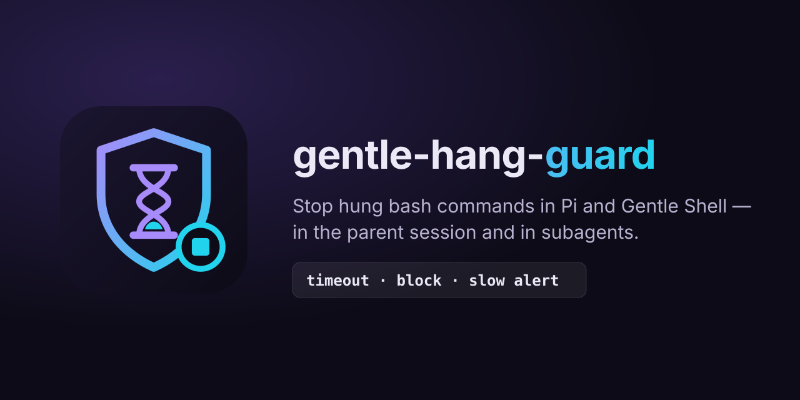

<p align="center"></p>

<p align="center"><a href="README.md">English</a> · <b>Español</b></p>

# gentle-hang-guard

Detiene comandos `bash` colgados en Pi / [Gentle Shell](https://gentlemanprogramming.com/gentle-hub/) antes de que se coman tu sesión. Funciona en la sesión principal **y en los subagentes**:

| Protección | Qué hace |
| --- | --- |
| **Timeout por defecto** | Toda llamada a `bash` sin `timeout` recibe uno (`HANG_GUARD_DEFAULT_TIMEOUT_S`, por defecto **120 s**). Un `timeout` explícito y válido nunca se modifica. |
| **Bloqueo de patrones peligrosos** | Bloquea `--root /` (y `--root=/`) y un `wait` sin argumentos en un comando que también lanza trabajos en segundo plano con `&`, con una sugerencia para el agente. |
| **Aviso de comando lento** | Avisa una vez cuando una llamada a `bash` supera `HANG_GUARD_SLOW_ALERT_S` (por defecto **300 s**). |

`HANG_GUARD_DISABLE=1` lo desactiva todo.

## Instalación

```bash
pi install git:github.com/BlazzzPlay/gentle-hang-guard
```

Requisitos: Pi (se recomienda Gentle Shell para los subagentes) y Node.js 22+.

## Por qué hace falta

La herramienta `bash` de Pi tiene un `timeout` opcional **sin valor por defecto**: un comando que nunca termina bloquea al agente hasta que otra cosa lo mata. Dos cuelgues reales motivaron esta extensión:

1. Un `wait` sin argumentos en un script que había lanzado un servidor de desarrollo con `&`. `wait` espera a todos los trabajos, incluido el servidor, así que la llamada quedó colgada unos **15 minutos**.
2. `vitest run --root /` recorrió todo el sistema de archivos durante unos **23 minutos**.

Gentle Shell ya tiene un watchdog de bloqueo para subagentes, y esta extensión lo complementa:

| | Watchdog de Gentle Shell | gentle-hang-guard |
| --- | --- | --- |
| Alcance | Solo subagentes | Sesión principal y subagentes |
| Cuándo actúa | Sin actividad durante 4 min, o 30 min con una herramienta en curso (configurable en `subagents.json`) | Por cada llamada a `bash`: 120 s por defecto |
| Qué detiene | El subagente **completo** | Solo el comando colgado; el agente sigue trabajando y ve el error |

## Patrones bloqueados

El bloqueo llega al agente como error de la herramienta, así puede corregir el comando por sí mismo:

| Patrón | Mensaje (resumido, en inglés en la extensión) |
| --- | --- |
| `--root /`, `--root=/` | Apunta `--root` al directorio del proyecto (por ejemplo `--root .`). |
| `wait` sin argumentos + trabajos `&` | Guarda los PID y espéralos explícitamente (`cmd & pid=$!; …; wait $pid`), o ejecuta los servidores con `bash_background`. |

Las cadenas entre comillas, los comentarios, el cuerpo de los heredoc, `&&` y las redirecciones como `2>&1` no se confunden con estos patrones. `wait $pid` está permitido.

## Configuración

| Variable | Por defecto | Significado |
| --- | --- | --- |
| `HANG_GUARD_DEFAULT_TIMEOUT_S` | `120` | Timeout (segundos) que se agrega a las llamadas a `bash` que no tienen uno |
| `HANG_GUARD_SLOW_ALERT_S` | `300` | Segundos antes del aviso único de comando lento |
| `HANG_GUARD_DISABLE` | sin definir | `1` desactiva la extensión |

Los valores inválidos (no numéricos, cero, negativos) vuelven al valor por defecto. Los subagentes heredan el entorno, así que la misma configuración se aplica allí.

### Un comando largo

El timeout por defecto solo completa un valor ausente. Para un único comando largo (un build completo, una suite de tests grande):

- pasa `timeout` explícitamente en la llamada a `bash` (por ejemplo `timeout: 1800`), o
- ejecútalo con `bash_background` y revísalo después.

## Comportamiento verificado y limitaciones

- **También se matan los trabajos en segundo plano.** Pi ejecuta cada llamada a `bash` en su propio grupo de procesos y mata el árbol de procesos al vencer el timeout, así que los trabajos `&` que lanzó el comando mueren con él (verificado en una ejecución real de Pi).
- **Los procesos que salen del grupo pueden escapar.** Lo que se separe con `setsid` o `nohup … & disown` puede sobrevivir al timeout. Sin probar.
- **En los subagentes el aviso de comando lento no llega al agente principal.** El aviso usa `ui.notify`, y el runner de Gentle Shell hoy descarta los mensajes notify de un subagente. Dentro de los subagentes solo actúa el timeout por defecto. Un issue para Gentle Shell se enlazará aquí cuando se publique.

## Desarrollo

```bash
npm test   # node --test, sin dependencias
```

## Built with Gentle-AI

<div align="center">

<a href="https://github.com/Gentleman-Programming/gentle-ai">
  
</a>

</div>

## Licencia

[MIT](LICENSE) © 2026 Fabian Mendoza
