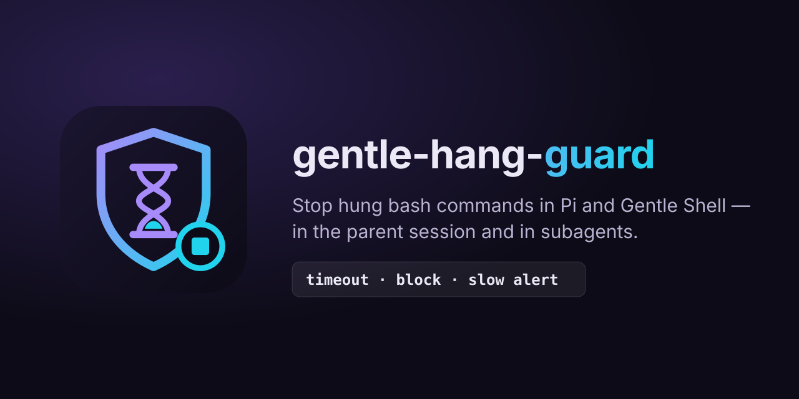

<p align="center"></p>

<p align="center"><b>English</b> · <a href="README.es.md">Español</a></p>

# gentle-hang-guard

Stop hung `bash` commands in Pi / [Gentle Shell](https://gentlemanprogramming.com/gentle-hub/) before they eat your session. It works in the parent session **and in subagents**:

| Guard | What it does |
| --- | --- |
| **Default timeout** | Every `bash` call without a `timeout` gets one (`HANG_GUARD_DEFAULT_TIMEOUT_S`, default **120 s**). An explicit valid `timeout` is never changed. |
| **Dangerous-pattern block** | Blocks `--root /` (and `--root=/`) and a bare `wait` in a command that also starts background `&` jobs, with a suggestion for the agent. |
| **Slow-command alert** | Warns once when a `bash` call runs past `HANG_GUARD_SLOW_ALERT_S` (default **300 s**). |

`HANG_GUARD_DISABLE=1` turns everything off.

## Install

```bash
pi install git:github.com/BlazzzPlay/gentle-hang-guard
```

Requirements: Pi (Gentle Shell recommended for subagents) and Node.js 22+.

## Why it is needed

Pi's `bash` tool has an optional `timeout` with **no default**: a command that never ends blocks the agent until something else kills it. Two real hangs that motivated this extension:

1. A bare `wait` in a script that had started a dev server with `&`. `wait` waits for every job, including the server, so the call hung for about **15 minutes**.
2. `vitest run --root /` scanned the whole filesystem for about **23 minutes**.

Gentle Shell already has a subagent stall watchdog, and this extension complements it:

| | Gentle Shell stall watchdog | gentle-hang-guard |
| --- | --- | --- |
| Scope | Subagents only | Parent session and subagents |
| When it acts | No activity for 4 min, or 30 min with a tool in flight (configurable in `subagents.json`) | Per `bash` call: 120 s by default |
| What it stops | The **whole** child agent | Only the hung command; the agent keeps working and sees the error |

## Blocked patterns

The block reaches the agent as the tool error, so it can fix the command itself:

| Pattern | Message (shortened) |
| --- | --- |
| `--root /`, `--root=/` | Point `--root` at the project directory (for example `--root .`). |
| bare `wait` + `&` jobs | Save PIDs and wait on them explicitly (`cmd & pid=$!; …; wait $pid`), or run servers with `bash_background`. |

Quoted strings, comments, heredoc bodies, `&&` and redirections such as `2>&1` are not mistaken for these patterns. `wait $pid` is allowed.

## Configuration

| Variable | Default | Meaning |
| --- | --- | --- |
| `HANG_GUARD_DEFAULT_TIMEOUT_S` | `120` | Timeout (seconds) added to `bash` calls that have none |
| `HANG_GUARD_SLOW_ALERT_S` | `300` | Seconds before the one-time slow-command warning |
| `HANG_GUARD_DISABLE` | unset | `1` disables the extension |

Invalid values (non-numeric, zero, negative) fall back to the default. Subagents inherit the environment, so the same settings apply there.

### One long command

The default timeout only fills in a missing value. For a single long command (a full build, a big test suite):

- pass `timeout` explicitly in the `bash` call (for example `timeout: 1800`), or
- run it with `bash_background` and check on it later.

## Verified behavior and limitations

- **Background jobs are killed too.** Pi runs each `bash` call in its own process group and kills the process tree on timeout, so `&` jobs started by the command die with it (verified in a real Pi run).
- **Processes that leave the group may escape.** Anything detached with `setsid` or `nohup … & disown` may survive the timeout. Untested.
- **In subagents the slow alert does not reach the parent.** The alert uses `ui.notify`, and the Gentle Shell runner currently drops a child's notify messages. Inside subagents only the default timeout acts. An issue for Gentle Shell will be linked here once it is published.

## Develop

```bash
npm test   # node --test, no dependencies
```

## Built with Gentle-AI

<div align="center">

<a href="https://github.com/Gentleman-Programming/gentle-ai">
  
</a>

</div>

## License

[MIT](LICENSE) © 2026 Fabian Mendoza
